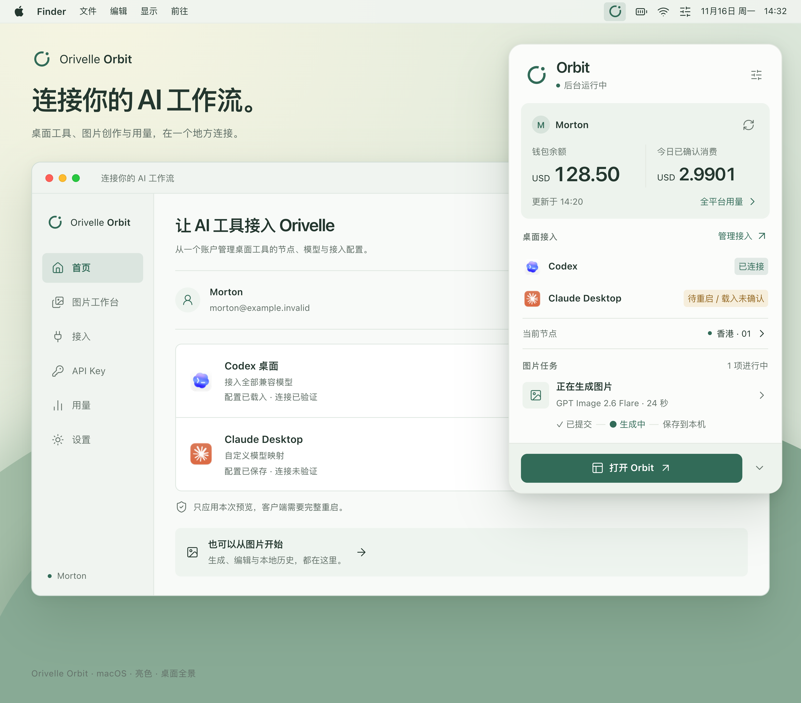

  

<h1 align="center">Orivelle Orbit</h1>

Orbit 是 Orivelle 的桌面应用。用同一个账户连接 Codex 和 Claude Desktop，在图片工作台生成、编辑和保存图片，并查看账户预算、平台用量和实际消费。

  <picture>
    <source media="(prefers-color-scheme: dark)" srcset="docs/assets/showcase/desktop-macos-dark.png">
    <source media="(prefers-color-scheme: light)" srcset="docs/assets/showcase/desktop-macos-light.png">
    
  </picture>

界面预览 · 使用示例数据

## 📦 获取 Orbit

从 [Releases](https://github.com/Orivelle-Labs/Orbit/releases/latest) 下载适合你设备的安装包。

- **macOS**（Apple 芯片，macOS 15 或更高版本）下载 `.dmg`，打开后将 Orbit 拖到「应用程序」。
- **Windows**（x64）下载以 `-setup.exe` 结尾的安装包，双击并按提示安装。

如果首次打开时 macOS 提示无法验证开发者，请确认安装包来自本仓库，然后在「系统设置」的「隐私与安全性」中选择「仍要打开」。

## 🚀 开始使用

在 Orbit 中选择「连接账户」，在系统浏览器中登录 Orivelle 并授权。登录后，在「API Key」选择或创建密钥，再到「接入」配置桌面工具，或在「图片工作台」生成和编辑图片。

## 🔑 管理 API Key

「API Key」支持搜索、状态筛选、详情、创建、编辑、轮换、重置消费计数、撤销和删除。金额限额、滚动窗口与速度策略复用 Panel 的现有规则。只读账户按现有权限查看密钥；管理和领取接入凭据需要可写权限。

默认密钥保存在当前设备，选择时由原生层交付至系统凭据存储。主动查看时，明文只临时显示，30 秒后或窗口失焦时隐藏；复制直接通过原生剪贴板完成。

默认密钥统一在「API Key」页面选择。「接入」页面直接使用该默认密钥，确认弹窗只展示节点和密钥，取消接入仅保留简短确认。每个已接入工具显示实际绑定；改用新默认时可选择「更新接入」，完成后重启客户端。

旧版本升级后，需要重新连接并授予 Key 管理权限。Panel 会清理明确关联的旧版 Orbit 自动密钥，列表不再保留这些选项；手动创建的密钥保留。选择正常密钥后重新接入。网络中断导致管理操作结果未知时，先选择「核对结果」，避免重复创建或轮换。Panel 也需更新到提供这些接口的版本。

## 🔌 连接 Codex 和 Claude Desktop

Orbit 可以为支持现有配置格式的桌面应用保存 Orivelle 接入配置。

### 兼容性

自动配置适用于搭载 Apple 芯片的 Mac 和 Windows x64，并要求使用应用的默认配置位置。Windows 支持官方 MSIX 安装，以及具备相同配置能力的官方 EXE 安装；Codex 官方离线桌面包目前采用 MSIX。

Orbit 按应用身份、所需配置功能和本地文件结构检查兼容性，不以精确版本号或固定应用文件指纹限制接入。升级级别本身不会使接入失效；只要配置格式仍兼容，即可继续预览、应用或恢复。若预览期间应用发生更新，请重新预览。使用自定义配置或设备受组织管理时，Orbit 会说明具体限制。

### 接入与切回

1. 在 Orbit 连接 Orivelle 账户，打开「接入」。
2. 在「API Key」页面设好默认密钥，再到「接入」选择节点。Codex 接入此节点和账户下的全部兼容模型，并以目录中第一个兼容模型作为默认值。Claude Desktop 分别为 Sonnet、Opus、Haiku 选择实际调用的模型。
3. Claude 的三项模型映射均需选择；可以明确匹配到对应系列时会预填，仍可自行调整。选择「接入 Orbit」，核对基本信息并确认。接入后保留三个选择框，显示实际绑定的模型并禁用编辑。完整退出对应的桌面应用，再重新打开。
4. 要恢复接入前的配置，选择「取消接入」，确认后重新启动对应的工具。Orbit 会为每个工具保留独立的切换快照。

Orbit 启动时及运行期间每 5 分钟会同步当前账户和节点的可用模型，收起窗口后仍会同步。已接入 Codex 的目录会更新全部兼容模型，保留仍可用的默认模型；默认模型失效时改用目录中的首个兼容项。模型的调用 ID 和显示名称按平台提供的值保留，可以与上游模型名不同。目录保存后如 Codex 未显示更新，请重新启动 Codex。

Windows 和 macOS 上，打开 Codex 或 Claude Desktop 的「确认接入」窗口后，Orbit 开始核对本机配置、节点和模型。窗口没有确认时限。点击确认时会再次核对当前状态，遇到实际变化会显示原因并允许重新检查。Claude 的本机转发端口在点击确认后分配。

Orbit 按字段更新 `config.toml` 中的默认模型、供应商、模型目录和推理档位。如果活动 profile 覆盖了这些字段，会一并更新。其他 profile、已有供应商、MCP 和个人偏好会保留，`auth.json` 继续由原客户端或切换器管理。

接入时，Orbit 加密备份完整的配置文件和专用模型目录，并记录文件原先是否存在。取消接入时，未经修改的文件会逐字节还原。接入后仅改动个人偏好时，取消接入会保留这些改动并恢复原来的模型和供应商。如果其他切换器已接管当前路由，或专用模型目录被改写，Orbit 会暂停覆盖。

同步沿用该工具原先确认的节点与 API Key。顶部「刷新数据」反馈所请求数据的读取结果。后台确认没有兼容模型、需要处理模型配置时才提醒，同一问题只提醒一次。短暂断网或路由冲突时暂停写入。

Claude 接入时会加密备份三个目标文件的原始内容和存在状态。取消接入时，内容未变化的文件会逐字节还原。如果期间新增了 MCP 设置、偏好或其他切换器的配置条目，Orbit 会保留这些改动，恢复接入前的模式和活动配置，并移除自己的条目。如果活动配置已经切换、Orbit 条目已被编辑或原活动配置无法核实，Orbit 会停止覆盖。

Claude Desktop 的 Sonnet、Opus、Haiku 入口分别对应所选模型，直接显示所选模型名称，实际请求使用所选模型 ID。已接入配置的显示名称在重新接入后更新。请求通过本机 Orbit 转发，使用时请保持 Orbit 运行。

节点旁显示 Orbit 本机到节点入口的 HTTP 往返延时。打开「接入」后自动测速，页面在前台时每 30 秒更新，也可选择「刷新延时」。切换页面、收起窗口或退出登录后暂停，过期结果会标注。探测只访问健康端点，不调用模型；模型响应速度还受上游和负载影响。

### 常见问题

- **没有可选模型或节点**。确认账户已连接，选择可用的节点并刷新。仍缺少某个模型时，请联系账户管理员确认权限。
- **无法预览或应用配置**。核对应用版本和安装状态。如果提示组织限制，请联系设备管理员。
- **Claude 提示需要迁移旧配置**。请先在 Claude 中按提示完成，再退出 Claude 并回到 Orbit 重新预览。
- **恢复时提示配置冲突**。其他应用或手动编辑可能已改变配置。Orbit 会暂停覆盖。请先处理冲突，再预览恢复。

## 🎨 使用图片工作台

连接 Orivelle 账户后即可在「图片工作台」准备提示词、添加参考图，或从本地历史再次编辑图片。提交图片请求前需选择可用节点和 API Key；按钮旁会说明尚未满足的条件，并提供选择密钥或管理接入的入口。同一账户连接下，切换页面、选择密钥或节点会保留当前草稿；退出登录或切换账户会清空草稿。

### 生成或编辑图片

1. 在「创作」中选择模型，描述想要的画面或修改要求。
2. 编辑已有图片时，选择「添加参考图」或拖入 PNG、JPEG 或 WebP 图片。普通订阅请求最多五张；模型开放高级图像 API 后最多十六张，超过五张会使用高级服务。
3. 选择图片模型后，「高级选项」默认折叠，背景预选「不透明」，可展开后切换为「透明」。收起后已选设置继续生效，再选择「生成图片」或「编辑图片」。普通订阅请求每次一张结果；透明背景可能增加图片 token 用量。

背景选项只提供「不透明」和「透明」；Orbit 明确传送选中的值，不提供「使用服务默认值」。再次编辑历史图片时，可在当前模型的高级选项中调整背景。

「高级选项」目前仅开放「背景」。数量、尺寸、质量、格式、压缩率、画面规划复杂度、内容审核、流式预览、输入保真度、蒙版和标注等其他选项暂不开放。

默认数量一张、自动质量和尺寸、PNG 格式及不透明/透明背景继续使用订阅服务。使用高级图像 API 的请求会在生成按钮上方提示，并按高级销售价计费。缺少专用服务时，错误只列本次调整但暂不支持的参数。

Orivelle 会处理你提交的提示词和参考图。收到的图片保存在本机。

### 保存和再次使用

在「本地历史」可查看、复制、另存图片，也可选择「再次编辑」。卡片默认以请求 ID 为标题，没有请求 ID 的旧记录使用本地图片 ID；长标题以省略号截断，悬停可查看完整标题。点击标题旁的编辑按钮可修改本地标题，留空恢复默认标题，原始请求 ID 保持不变。第二行展示格式、实际分辨率和文件大小，例如 `PNG · 1536 × 1024 · 1.9 MiB`，下一行展示生成时间。历史缩略图框保持统一尺寸，框内图片按原始比例完整显示。生成结果预览与放大图片保持原始比例。任务详情展示创建任务时保存的模型显示名称和 Request ID。

SVG 以渲染后的图片预览和复制，保存保留 SVG 原文件。GIF 使用缩小的动图预览，「复制首帧」复制静态图片，保存保留原尺寸和完整动画。SVG/GIF 需先转换为 PNG、JPEG 或 WebP，才能作为参考图再次编辑。

### 查看状态和费用

如果提示「本地保存失败」，请检查可用空间，再选择「重试本地保存」，保存已收到的图片。

取消等待或网络中断后，已提交的任务仍可能完成并计费。若显示「结果待确认」，请先点击「刷新」查看记录，再决定是否重新提交；费用可在「用量」中查看。

实际费用以 Orivelle 的消费记录为准。

## 📊 查看用量

「用量」展示当前登录账户通过全部平台入口产生的调用与消费。可以选择今天、近 7 天、近 30 天或自定义时段，一次最多查询 90 个自然日。

顶部显示请求数、Token 用量、已确认消费和待确认费用笔数；趋势可切换请求量与已确认消费。不同币种分开展示。下方调用记录支持结果筛选、分页及展开请求详情，结果筛选只作用于调用记录。

汇总可能稍晚于调用记录；未知或待确认费用保留原状态。只读账户也可以查看本人用量，无需推理凭据或选择节点。用量查询不改变平台余额、预算或结算记录。

## ⚙️ 账户、更新与设置

### 查看余额和预算

连接账户后，在首页查看余额或可用预算。窗口顶部的「刷新数据」会更新账户、节点、模型目录和本地状态。

### 检查更新

在支持应用内更新的 Mac 与 Windows 正式版本中，默认开启「启动时检查更新」，也可在「设置」的「更新」手动选择「检查更新」。已有用户保存的开关选择会保留。检查结果在右下角提示；发现新版本后选择「下载并更新」，下载时可查看进度或取消。下载完成后会提示「安装并重启」，请先完成当前任务再确认。下载超时或中断后可以重新下载。

旧版 Windows 需要先从 **Releases** 下载支持应用内更新的新版安装包，手动升级一次。两个平台也都可以从发布页下载安装包，按提示手动更新。

### 设置和诊断

在「设置」可调整主题、语言、图片磁盘和预览缓存上限。图片空间达到上限时，Orbit 会暂停接收新任务。可先另存需要保留的图片，再清理本地历史。

Orbit 运行时会在 macOS 菜单栏或 Windows 系统托盘显示图标。关闭窗口默认收起到此图标，图片任务和 Claude 本地转发继续运行。Mac 后台运行时隐藏 Dock 图标。单击菜单栏或系统托盘图标会展开快捷面板，可查看账户余额或预算、今日全平台已确认消费、桌面接入状态和图片任务，再选择对应入口或「打开 Orbit」恢复主窗口。面板跟随 Orbit 的主题与语言设置；主题为「跟随系统」时随系统外观变化。Windows 面板从托盘所在屏幕的任务栏旁展开，使用较小圆角和无尖角布局。再次点击图标、点击面板外部或按 `Esc` 可收起。左右键打开同一快捷面板，「更多操作」提供设置与退出；Windows 也可双击托盘图标打开主窗口。再次启动 Orbit 也会唤回已有窗口。

常驻菜单可查看运行状态、打开设置或选择「退出 Orbit」。在「设置」的「窗口行为」中，也可改为关闭窗口时退出应用。有进行中的任务或未保存结果时，退出前会提示影响。真正退出后 Claude 本地转发停止，未确认的图片任务保留待确认状态。

macOS 的应用菜单也提供相同入口，可用 `⌘,` 打开设置、`⌘Q` 退出。

遇到问题时，请记录 Orbit 版本、操作系统和界面提示。需要提供诊断报告时，在「设置」的「诊断」中先预览，再保存。

## 📄 许可证

Orbit 采用 Apache-2.0 许可证。 [许可证正文](LICENSE) · [版权声明](NOTICE)
